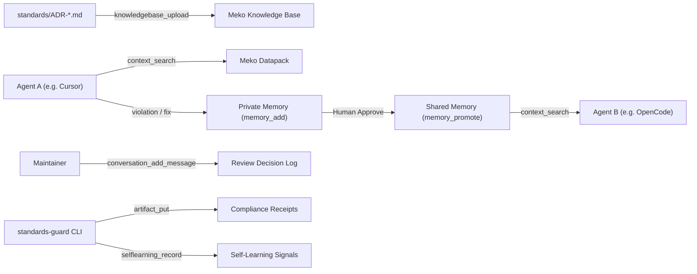

# Meko Standards Guard

**One Memory, Every Coding Agent** — Governed architecture and financial invariant enforcement backed by **YugabyteDB Meko**.

Coding agents normally start every session from zero. Standards Guard codifies repository Architecture Decision Records (ADRs), postmortem learnings, and compliance receipts into a single Meko datapack so Cursor, OpenCode, Claude Code, Codex, Kiro, and VS Code Copilot share the same institutional memory with human-in-the-loop governance.

## Architecture (5 Meko Primitives)



## Quickstart (Zero-Key Offline `--mock` Mode)

```bash
npm install
npm run build
npm run typecheck
npm test
npm run guard:seed -- --mode mock
npm run guard:status -- --mode mock
```

## Documentation

- [`docs/PRD.md`](./docs/PRD.md) — Product Requirements, ContextCon judging alignment, functional specs (`FR-1`–`FR-9`), and metrics.
- [`docs/ARCHITECTURE.md`](./docs/ARCHITECTURE.md) — End-to-end ADLC architecture, 5 Meko primitives, 3-mode client, and `S1`–`S8` enforcement matrix.
- [`docs/ROADMAP.md`](./docs/ROADMAP.md) — 7-week delivery milestones, Meko Free-tier quota budget, and demo execution plan.

## Switching to Live Meko MCP

1. Create a free datapack at Meko and obtain your bearer token.
2. Copy `.env.example` to `.env` and set `MEKO_API_TOKEN` and `GUARD_MODE=live`.
3. Seed the 8 ADRs into your Meko datapack:
   ```bash
   npm run guard:seed -- --mode live
   npm run guard:status -- --mode live
   ```
4. Connect your coding agents using the templates in [`agent-configs/`](./agent-configs/README.md).

## Monorepo Layout

- `packages/core` (`@meko-guard/core`): Config loader, 5-pillar Meko client (`mock` / `record` / `live`), and schema types.
- `packages/payledger` (`@meko-guard/payledger`): Local double-entry financial core API (Hono + Drizzle ORM + SQLite) enforcing `S1`–`S7` invariants.
- `packages/guard-cli` (`@meko-guard/cli`): CLI (`seed`, `status`, and upcoming ADLC gates + MCP server).
- `packages/guard-engine` *(Week 3)*: `ts-morph` AST & PII taint analyzer, spec checker, Vitest invariant runner, and blast-radius mapper.
- `packages/guard-ui` *(Week 5)*: Local Governance Control Plane (`localhost:4321`) for human promotion reviews and audit timeline.
- `standards/`: 8 financial, security, architecture, and governance ADRs (`ADR-001` through `ADR-008`).
- `specs/`: Sample RFC specs for pre-implementation spec checking.
- `agent-configs/`: Ready-to-use MCP templates for 6 coding agents.
- `docs/`: Product requirements, architecture specification, and hackathon execution roadmap.
- `fixtures/meko/`: Local JSON snapshots for zero-quota offline testing.
