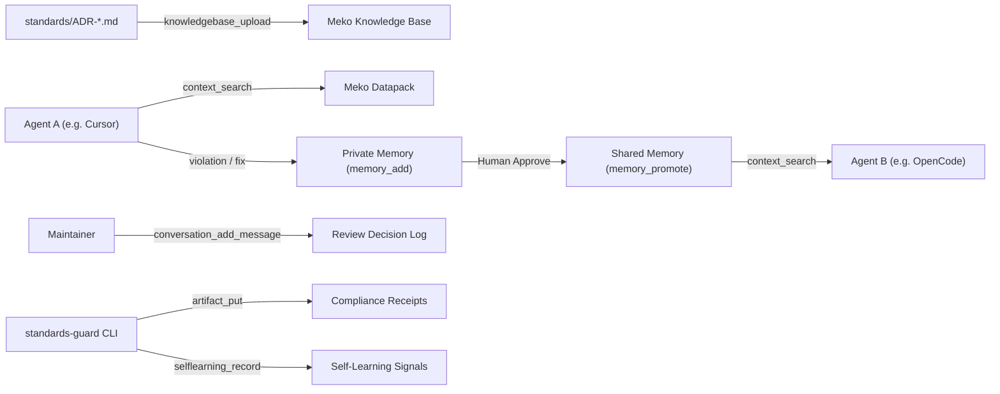

# Meko Standards Guard

**One Memory, Every Coding Agent** — Governed architecture and financial invariant enforcement backed by **YugabyteDB Meko**.

Coding agents normally start every session from zero. Standards Guard codifies repository Architecture Decision Records (ADRs), postmortem learnings, and compliance receipts into a single Meko datapack so Cursor, OpenCode, Claude Code, Codex, Kiro, and VS Code Copilot share the same institutional memory with human-in-the-loop governance.

## Architecture (5 Meko Primitives)



## Quickstart (Zero-Key Offline `--mock` Mode)

```bash
npm install
npm run build
npm run typecheck
npm test
npm run guard:seed -- --mode mock
npm run guard:status -- --mode mock
npm run guard:ui -- --mode mock
```

## CLI & Control Plane Commands

- `npm run guard:spec-check -- specs/001-refunds-rfc.md --mode mock` — pre-implementation RFC check against `S1`–`S8`
- `npm run guard:check -- --agent cursor --files <file.ts> --mode mock` — deterministic AST + PII taint + governance diff check (records private candidate memory on violation)
- `npm run guard:queue -- --mode mock` / `npm run guard:approve -- <memoryId> --reason "..."` — human review & `memory_promote` (`private -> shared`)
- `npm run guard:impact -- ADR-003` — map an ADR/rule to PayLedger files, routes, and tests
- `npm run guard:release-gate -- --mode mock` — full AST + Vitest verification emitting a SHA-256 compliance receipt artifact
- `npm run guard:bench -- --mode mock` — `tiktoken/cl100k_base` prompt-budget dry-run and A/B scorer
- `npm run guard:mcp -- --mode mock` — native stdio MCP server (`guard_preflight`, `guard_spec_check`, `guard_verify_diff`, `guard_explain_rule`, `guard_blast_radius`, `guard_queue_list`, `guard_release_gate`)
- `npm run guard:ui -- --mode mock` — local Governance Control Plane at `http://127.0.0.1:4321`

## 5-Task A/B Benchmark Summary (`fixtures/benchmark/results.json`)

Measured via `tiktoken/cl100k_base` and scored deterministically by `@meko-guard/engine` across 5 PayLedger tasks (`T1`–`T5`):

- **Rule Violations**: `15 -> 0` (`-100%`)
- **Average Correction Turns**: `1.8 -> 0`
- **Prompt Tokens**: `9,725 -> 1,089` (`-88.8%`)

## Documentation

- [`docs/PRD.md`](./docs/PRD.md) — Product Requirements, ContextCon judging alignment, functional specs (`FR-1`–`FR-9`), and metrics.
- [`docs/ARCHITECTURE.md`](./docs/ARCHITECTURE.md) — End-to-end ADLC architecture, 5 Meko primitives, 3-mode client, and `S1`–`S8` enforcement matrix.
- [`docs/ROADMAP.md`](./docs/ROADMAP.md) — 7-week delivery milestones, Meko Free-tier quota budget, and demo execution plan.
- [`docs/DEMO_SCRIPT.md`](./docs/DEMO_SCRIPT.md) — `< 4:30` demo video script, voiceover beats, and zero-quota rehearsal runbook.

## Switching to Live Meko MCP

1. Create a free datapack at Meko and obtain your bearer token.
2. Copy `.env.example` to `.env` and set `MEKO_API_TOKEN` and `GUARD_MODE=live`.
3. Seed the 8 ADRs into your Meko datapack:
   ```bash
   npm run guard:seed -- --mode live
   npm run guard:status -- --mode live
   ```
4. Connect your coding agents using the templates in [`agent-configs/`](./agent-configs/README.md).

## Monorepo Layout

- `packages/core` (`@meko-guard/core`): Config loader, 5-pillar Meko client (`mock` / `record` / `live`), and schema types.
- `packages/payledger` (`@meko-guard/payledger`): Local double-entry financial core API (Hono + Drizzle ORM + SQLite) enforcing `S1`–`S7` invariants.
- `packages/guard-engine` (`@meko-guard/engine`): `ts-morph` AST & PII taint analyzer, spec checker, Vitest invariant runner, and blast-radius mapper.
- `packages/guard-cli` (`@meko-guard/cli`): Full ADLC CLI (`seed`, `status`, `spec-check`, `check`, `queue`, `approve`, `impact`, `release-gate`, `bench`), `tiktoken` A/B harness, and native stdio MCP server (`mcp`).
- `packages/guard-ui` (`@meko-guard/ui`): Local Governance Control Plane (`localhost:4321`) for human promotion reviews, timeline audit, blast radius, and A/B benchmark visualization.
- `standards/`: 8 financial, security, architecture, and governance ADRs (`ADR-001` through `ADR-008`).
- `specs/`: Sample RFC specs for pre-implementation spec checking.
- `agent-configs/`: Ready-to-use MCP templates for 6 coding agents.
- `docs/`: Product requirements, architecture specification, hackathon roadmap, and demo script.
- `fixtures/meko/`: Local JSON snapshots for zero-quota offline testing.
- `fixtures/benchmark/`: Reproducible 5-task A/B run inputs (`runs/`) and scored `results.json`.
