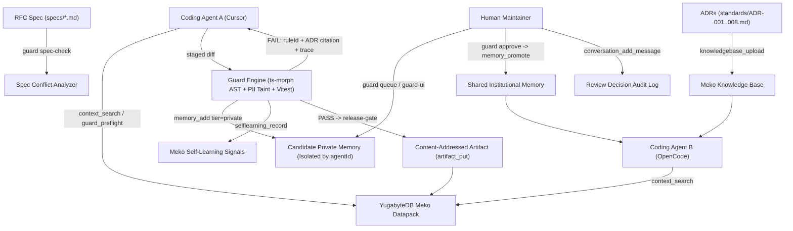

# System Architecture: Meko Standards Guard

This document describes the system topology, monorepo packages, YugabyteDB Meko integration, and static/dynamic enforcement rules for **Meko Standards Guard**.

---

## 1. End-to-End ADLC Architecture

---

## 2. Monorepo Package Architecture

Root workspace uses npm workspaces (`packages/*`), TypeScript `NodeNext` ESM (`"type": "module"`), and Vitest (`vitest.config.ts`).

| Package | Name | Responsibility & Key Exports | Status |
| :--- | :--- | :--- | :--- |
| `packages/core` | `@meko-guard/core` | Zod config & ADR loader (`loadGuardConfig`, `loadAdrDocuments`), `MekoClient` interface, 3-mode client factory (`MockMekoClient`, `RecordingMekoClient`, `LiveMekoClient` over `@modelcontextprotocol/sdk` `StreamableHTTPClientTransport`), quota counter. | **Implemented** |
| `packages/payledger` | `@meko-guard/payledger` | Local double-entry financial API (Hono + Drizzle ORM + `better-sqlite3`): 5 tables, `multiplyBpsBankers`, `requireIdempotency`, `postBalancedEntries`, `toPublicMerchantDto`, `createPayout` atomic lock, `verifyWebhookSignature`. | **Implemented** |
| `packages/guard-engine` | `@meko-guard/engine` | Deterministic enforcement engine: `ts-morph` AST checker, PII data-flow taint analyzer, dynamic Vitest invariant runner, spec conflict checker, and ADR-to-code blast-radius mapper. | Planned (Week 3) |
| `packages/guard-cli` | `@meko-guard/cli` | CLI (`standards-guard`: `seed`, `status`, plus upcoming `spec-check`, `check`, `queue`, `approve`, `impact`, `release-gate`, `bench`) and native stdio MCP server (`mcp`). | Partial (`seed`, `status` done; Week 4) |
| `packages/guard-ui` | `@meko-guard/ui` | Local Governance Control Plane (React + Vite + Tailwind on `localhost:4321`): Approval Queue, Cross-Agent Timeline, Blast-Radius Graph, A/B Token Benchmark. Reads local snapshot by default to save Meko quota. | Planned (Week 5) |

---

## 3. YugabyteDB Meko 5-Primitive Integration

All 5 primitives operate against a single datapack (`payledger-standards-guard` in [`guard.config.json`](../guard.config.json)):

| Meko Primitive | MCP Tool(s) | Client Method (`MekoClient`) | Role in Standards Guard |
| :--- | :--- | :--- | :--- |
| **Knowledge Base** | `knowledgebase_upload`, `knowledgebase_search` | `knowledgebaseUpload`, `knowledgebaseSearch` | Stores canonical ADRs (`ADR-001` through `ADR-008`) uploaded by `standards-guard seed`. |
| **Memory (2-Tier)** | `memory_add`, `memory_search`, `memory_promote` | `memoryAdd`, `memorySearch`, `memoryPromote` | Violation traces & fix patterns enter as `tier: "private"` scoped to `agentId`. Only human approval calls `memoryPromote` to expose them as `tier: "shared"` across all agents. |
| **Conversations** | `conversation_add_message` | `conversationAddMessage` | Logs maintainer review decisions, promotion rationales, and release audit notes linked to `relatedMemoryId`. |
| **Artifacts** | `artifact_put`, `artifact_get` | `artifactPut`, `artifactGet` | Stores SHA-256 content-addressed JSON artifacts (`seed-summary.json`, compliance receipts from `release-gate`, benchmark summaries). |
| **Self-Learning** | `selflearning_record`, `selflearning_*` | `selfLearningRecord` | Records structured `violation_recorded` and `fix_verified` signals (`agentId`, `ruleId`, `pattern`, `remediation`) for cross-agent preflight recall. |
| **Unified Retrieval** | `context_search` | `contextSearch` | Single preflight query merging Knowledge ADRs, agent-scoped + shared Memories, Conversations, and Self-Learning signals. |

### Three Execution Modes (`GuardMode`)

Implemented in [`packages/core/src/meko-client.ts`](../packages/core/src/meko-client.ts):
1. **`mock`** (`MockMekoClient`): Reads and persists [`fixtures/meko/mock-datapack.json`](../fixtures/meko/mock-datapack.json) locally with deterministic tokenization scoring, SHA-256 artifact addressing, and strict `private` (`agentId`) vs `shared` memory isolation. Zero network calls, zero Meko quota consumption.
2. **`live`** (`LiveMekoClient`): Connects over HTTPS Streamable HTTP (`https://mcp.mekodata.ai/mcp`) using `MEKO_API_TOKEN` bearer authentication via `@modelcontextprotocol/sdk`.
3. **`record`** (`RecordingMekoClient`): Wraps `LiveMekoClient` and snapshots responses into local fixtures for deterministic offline replay during CI and presentation backup.

---

## 4. Rule Enforcement Matrix (`S1`–`S8`)

| Rule | ADR | Static Analysis (`ts-morph` AST / Taint) | Dynamic Runtime Verification (`vitest` / DB) | Target Paths (`packages/payledger`) |
| :--- | :--- | :--- | :--- | :--- |
| **S1** | `ADR-001` | Reject float literals (`0.11`, `/ 100`, `parseFloat`, `Math.round` on money identifiers) in financial calculations. | `money.test.ts` asserts exact `BigInt` half-to-even `multiplyBpsBankers` rounding and rejects non-integer cents (`assertSafeCents`). | `src/shared/money.ts`, `src/invoices/*`, `src/payouts/*` |
| **S2** | `ADR-002` | Verify `app.post(...)` routes for `/invoices`, `/payouts`, `/refunds`, `/reverse` apply `requireIdempotency` middleware. | `invariants.test.ts` verifies missing header returns `400`, identical replay returns `X-Idempotent-Replayed: true`, changed body returns `409 Conflict`. | `src/shared/idempotency.ts`, `src/invoices/routes.ts`, `src/payouts/routes.ts` |
| **S3** | `ADR-003` | Reject any `db.update(ledgerEntries)` or `db.delete(ledgerEntries)` (or `tx.update`/`tx.delete`) calls anywhere in `packages/payledger/src`. | `invariants.test.ts` verifies `getGlobalLedgerTotals` & `getGroupLedgerTotals` balance (`debitCents === creditCents`) and append-only `REVERSAL` rows. | `src/ledger/service.ts`, `src/payouts/service.ts` |
| **S4** | `ADR-004` | Taint-trace `merchants` row reads and PII identifiers (`bankAccountNumber`, `routingNumber`, `taxId`, snake_case equivalents) flowing into `c.json(...)` or `console.*` without `toPublicMerchantDto`. | `invariants.test.ts` inspects serialized JSON bodies from all `/merchants*` endpoints and rejected webhook logs to guarantee zero PII keys or raw values. | `src/accounts/dto.ts`, `src/accounts/routes.ts`, `src/webhooks/routes.ts` |
| **S5** | `ADR-005` | Verify payout/settlement balance checks (`getMerchantBalanceCents`) and ledger inserts execute inside the same `db.transaction(...)` callback. | `invariants.test.ts` fires concurrent `Promise.all` payout requests (`80%` balance each), asserting `201` + `422` and non-negative balance. | `src/payouts/service.ts` |
| **S6** | `ADR-006` | Verify `verifyWebhookSignature` / `timingSafeEqual` precedes `JSON.parse(rawBody)` in `src/webhooks/**`. | `webhook-signature.test.ts` + `invariants.test.ts` assert malformed JSON with bad HMAC returns `401` (not `400`), >300s timestamp returns `401`, and valid webhook captures once. | `src/webhooks/signature.ts`, `src/webhooks/routes.ts` |
| **S7** | `ADR-007` | Verify invoice retrieval routes/services read snapshot columns (`invoices`) without joining `merchants.feeBps`/`taxRateBps` to recalculate totals. | `invariants.test.ts` mutates merchant rates via `PATCH /merchants/:id/rates` after invoice creation and asserts historical invoice totals stay unchanged. | `src/invoices/service.ts`, `src/db/schema.ts` |
| **S8** | `ADR-008` | Flag unapproved git diffs modifying `standards/**/*.md`, `guard.config.json`, or official fee/tax governance files. | `MockMekoClient` unit tests (`meko-client.test.ts`) verify cross-agent isolation of `private` memories until `memoryPromote` is invoked. | `standards/**`, `guard.config.json`, `packages/core/src/meko-client.ts` |

---

## 5. Anti-Context-Poisoning Security Model

1. **Write-Quarantine (`tier: "private"`)**: Every automatic violation finding or agent fix pattern written via `memoryAdd` defaults to `tier: "private"` tagged with the originating `agentId` (e.g., `"cursor"`). Subsequent `contextSearch({ includePrivateForAgent: "opencode" })` queries **never** return unpromoted memories from another agent.
2. **Human Promotion Gate (`memoryPromote`)**: Only an explicit maintainer action (`guard approve <id> --reason "..."` or Governance UI click) flips `tier` to `"shared"`, stamps `promotedAt` / `promotedBy` / `promotionReason`, and records a permanent entry in Meko Conversations (`conversation_add_message`).
3. **Policy Immutability (`S8`)**: Coding agents are prevented from silently editing `standards/*.md` or `guard.config.json` to make failing tests pass; `guard check` blocks unapproved policy changes unless explicitly authorized by the maintainer.
